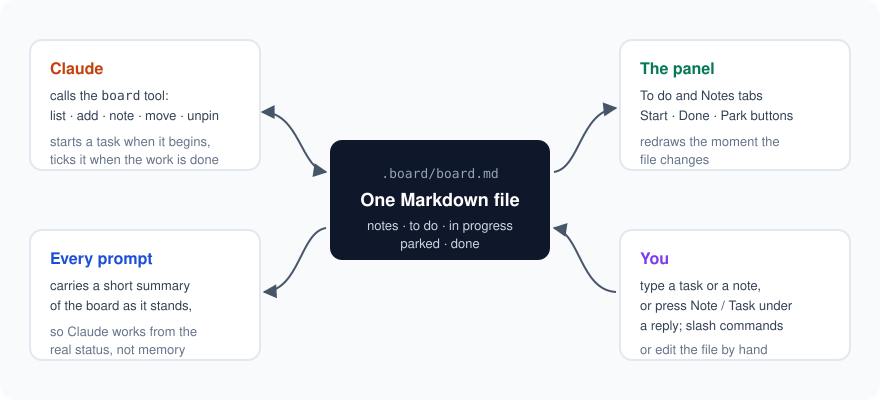

<p align="center">
  
</p>

<h1 align="center">Bookboard</h1>

<p align="center">
  <strong>A task board and pinned notes for every project, that Claude Code reads and writes itself.</strong>
</p>

<p align="center">
  <a href="LICENSE"></a>
  
  
  
</p>

---

In a long session with an AI assistant, the real status lives in the chat and
in your head. Decisions get lost, the assistant forgets what is open, and nobody
can say what is actually done.

Bookboard keeps that status in one plain Markdown file per project,
`.board/board.md`, and makes **Claude and you work on the same board**:

- **Claude sees the board with every prompt** and changes it through its own
  `board` tool: it starts a task when it begins and ticks it only when the work
  is finished.
- **A live panel beside the chat** shows your tasks and notes, with Start, Done
  and Park buttons, and redraws the moment anything changes the file.
- **Pinned notes are standing instructions** for that project, and Claude follows them.

## How it works

<p align="center">
  
</p>

Everything goes through one file you can read, edit by hand, and commit if you
like. Nothing leaves your machine: no server, no account, no network calls.

## Features

| | |
|---|---|
| **Two tabs** | **☑ To do** (In progress, To do, Parked, the last 5 Done) and **📌 Notes**, each with a count. |
| **One-click moves** | ▶ Start, ✓ Done, Park, Back, Unpark, Reopen and Unpin on every item. |
| **Add from anywhere** | Type into the panel, use a slash command, ask in plain words, or press **📌 Note** / **＋ Task** under any of Claude's replies to send that reply to the panel to trim. |
| **Claude's own tool** | `list`, `add`, `note`, `move` and `unpin`, naming an item by a few of its words. Ambiguous matches are asked about, never guessed. |
| **Real status in every prompt** | A short summary of the board is attached to each prompt, so Claude never works from a stale memory of it. |
| **Long items stay tidy** | Long titles are clipped with **more** / **less**; **bold** and `code` render as formatting. |
| **Multi-folder workspaces** | In a VS Code workspace with several folders, pick which folder's board to show, or type a path. |
| **Open and close in one click** | **📋 Board** under Claude's latest reply opens and closes the panel. |

## Install

At the prompt of a Claude Code terminal session:

```
/plugin install bookboard --marketplace PandaOnDiet/bookboard
```

Answer `y` to add the marketplace, then pick a scope. Or from a shell:

```
claude plugin install bookboard --marketplace PandaOnDiet/bookboard
```

In the desktop app: click **+** next to the prompt box, then **Plugins**, **Add
marketplace** with `PandaOnDiet/bookboard`, then add **bookboard**.

**Requirements:** Claude Code **2.1.310 or newer** (the panel uses Claude Code's
plugin hooks API, which is in early access), and Node on your PATH for the
session-start hook.

## Quick start

1. Open a project and start Claude Code. The panel opens beside the chat.
2. Press **Create the board**, or just ask: *"add a task to fix the login redirect"*.
3. Work as usual. Claude moves the task to In progress when it starts and to
   Done when it is finished, and you see it happen in the panel.

## The board file

Plain Markdown, five sections, always in this shape (example content):

```markdown
# Board

## Pinned notes
- Use **pnpm**, never npm _(2026-10-30)_

## To do
- [ ] Fix **login redirect** losing `returnTo` _(added 2026-10-30)_

## In progress
- [ ] Write the **release notes** _(started 2026-10-30)_

## Parked
- [ ] Dark mode — waiting on the design _(parked 2026-10-30)_

## Done
- [x] Add **rate limiting** to the API _(done 2026-10-29)_
```

## Commands

| Command | What it does |
|---|---|
| `/bookboard:task <text>` · `/bookboard:tasks` | Add a task · show the board |
| `/bookboard:note <text>` · `/bookboard:notes` | Pin a note · show the notes |
| `/bookboard:park <task> [because …]` | Park a task, with a reason |
| `/bookboard:done <task>` | Mark a task done |
| `/bookboard:capsule` | The board as text to paste into a new chat; nothing is written |
| `/show-board [folder]` | Open the panel, optionally on another folder's board |

Plain words work too: *"park that"*, *"mark it done"*, *"what's still open?"*.

## Good to know

- Built for the Claude Code terminal, the desktop app and the VS Code extension.
  It is used day to day in VS Code; the terminal and the desktop app are not
  yet tested by hand.
- The folder picker reads VS Code's own record of the open workspace (VS Code
  stable on Windows, macOS and Linux).
- Troubleshooting: set `BOOKBOARD_DEBUG` to a file path and the panel logs what
  it does there. Off by default.

## Roadmap

- **Any AI tool:** a standalone MCP server for the same board, so Codex, Gemini
  CLI, GitHub Copilot and Cursor can read and update it too.

## Development

```
git clone https://github.com/PandaOnDiet/bookboard
cd bookboard
claude --plugin-dir .          # run it from the folder
claude plugin test .           # 14 tests against Claude Code's plugin engine
```

Bugs are fixed test-first: each fix starts with a test that fails.

## License

[MIT](LICENSE) © 2026 PandaOnDiet
